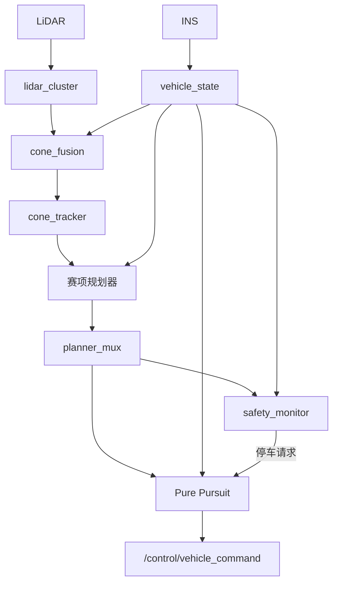

# HUAT FSAC 2026 无人驾驶系统

[](.github/workflows/ci.yml)
[](docs/CORE_ROS_BOUNDARY_ADR.md)
[](colcon_defaults.yaml)

面向 FSAC 无人赛车的 ROS 2 / C++20 工作区，包含锥桶感知、车辆状态处理、赛项规划、控制、安全监控，以及可复现的仿真与评测工具。

本项目从 ROS 1 工作区演进而来，重点是 ROS 2 接口契约、算法与适配层分离、控制闭环及故障场景验证；不宣称与往届实现完全等价，也不以仿真结果代替实车验收。

[环境与构建](#环境与构建) · [无界面演示](#无界面演示) · [启动与架构](#启动与架构) · [配置与接口](#配置与接口) · [开发与验证](#开发与验证) · [文档导航](#文档导航)

## 项目能力

- **感知与状态**：`lidar_cluster` 进行点云处理与锥桶聚类，`cone_fusion` / `cone_tracker` 负责坐标变换、融合与跟踪；`vehicle_state` 消费 INS 数据并发布车辆状态。
- **多赛项规划**：`urinay` 负责赛道循迹，`skidpad_planner` 负责八字绕环，`straight_line_planner` 负责直线加速；`velocity_profiler` 提供独立的速度剖面计算。
- **控制与安全**：提供 Pure Pursuit、MPC、规划输入监控、停车请求处理，以及可选的任务状态与车辆指令仲裁。
- **仿真与评测**：`vehicle_simulator` 提供自行车模型与传感器模拟，`track_benchmark` 提供赛道生成、离线 runner 与 KPI 评测；脚本覆盖闭环、故障注入和回归场景。
- **可视化与可选视觉**：`fsac_viz` 提供 RViz2 标记；`vision_ros` 含 Python 图像检测、ONNX Runtime 与 HSV 回退实现，主系统默认不启动视觉。

模块代码位于 [`src/`](src/)，启动编排位于 [`huat_launch`](src/launch/huat_launch/)。具体接线随入口不同，不能将所有已实现模块视为默认同时启用。

## 环境与构建

| 类别 | 配置 |
| --- | --- |
| CI 环境 | Ubuntu 24.04 + ROS 2 Jazzy，见 [CI 配置](.github/workflows/ci.yml)；其他发行版需单独验证 |
| 语言与中间件 | C++20、Python、`rclcpp` / `rclpy` |
| 构建 | colcon、ament / CMake；默认使用 `ccache` 与 `mold` |
| 模块依赖 | PCL、Eigen；可选视觉使用 OpenCV、NumPy、ONNX Runtime |

以下命令均在**本赛季工作区根目录**执行。先安装 ROS 2 Jazzy、colcon、rosdep，并完成 rosdep 初始化；不要混入 ROS 1 工作区环境。

```bash
source /opt/ros/jazzy/setup.bash
sudo apt update
sudo apt install -y ccache mold
rosdep update
rosdep install --from-paths src --ignore-src -r -y --rosdistro jazzy
colcon build --symlink-install
source install/setup.bash
```

[`colcon_defaults.yaml`](colcon_defaults.yaml) 配置 Release、C++20、4 个包级并行任务、mold、ccache，默认跳过 `hello_world` 并关闭 `BUILD_TESTING`。包级并行与单包编译并行不同；内存受限时按[构建指南](docs/BUILD_OPTIMIZATION.md)调整，不要直接提高并发数。

命令行传入 `--cmake-args` 会替换默认配置中的整个同名列表。启用测试时应沿用下方验证脚本或 [CI 的完整参数](.github/workflows/ci.yml)，避免无意丢失链接器、缓存与编译选项。

主传感器编排还依赖外部 `velodyne_pointcloud` 驱动包、`topic_tools` 和 `rviz2`。尤其 `velodyne_pointcloud` 未被 `huat_launch/package.xml` 完整声明，不能假设一次 rosdep 安装即可启动硬件链；需按所用 ROS 发行版另外准备驱动。

## 无界面演示

已构建并加载 ROS 与工作区环境后：

```bash
bash scripts/demo.sh
```

演示不启动 RViz，不需要显示器，结果写入 `build/demo/`；重复运行会重建该目录中的正常臂、故障臂输出。

| 场景 | 验证范围 |
| --- | --- |
| 正常臂：`closed_loop_sim_smoke.sh` | 脚本发布确定性参考路径，经速度规划、Pure Pursuit、车辆仿真器形成闭环；检查仿真时钟、车速、速度数组、指令帧和评测报告 |
| 故障臂：`fault_injection_smoke.sh` | 注入路径停发、空路径、指令帧异常、外部停车、任务锁存与节点退出等软件故障；检查检测、状态迁移与制动输出，并保存 JSON 时间线 |

任一臂失败，或故障证据缺失、字段不符，演示均非零退出。正常臂直接将控制指令送入仿真器，**不启动指令仲裁器**；故障臂另行验证仲裁与状态链路。

**验证边界**：正常臂使用脚本生成的路径，不验证“点云 → 锥桶 → 真实赛道规划”的质量。软故障验证不覆盖硬件急停、VCU 断连 / 掉电、真实底盘标定；相关测试仍需真实数据、台架或实车。

若 Fast DDS 的 UDP 组播发现受 VPN / 网络环境影响，可在调用前按本机条件设置：

```bash
export FASTDDS_BUILTIN_TRANSPORTS=SHM
```

这不是所有环境的必需配置。完整展示素材与真实数据验证分别由 [#26](https://github.com/zhangjszs/ROS2-LTS-Final/issues/26)、[#18](https://github.com/zhangjszs/ROS2-LTS-Final/issues/18)、[#19](https://github.com/zhangjszs/ROS2-LTS-Final/issues/19) 跟踪。

## 启动与架构

### 主系统入口

先查看参数，再根据数据源和硬件条件启动；主入口会启动传感器链、规划器、Pure Pursuit、安全监控与 RViz：

```bash
ros2 launch huat_launch fsac.launch.py --show-args
ros2 launch huat_launch fsac.launch.py road_type:=3
```

`road_type` 的初始选择为 `1` 八字、`2` 直线、`3` 赛道。运行期可通过 `/planner_mux/select` 选择规划输出；这只是路径话题选择，不代表整车任务已经完成无缝切换验证。

默认编排见 [`fsac.launch.py`](src/launch/huat_launch/launch/main/fsac.launch.py)，下图对应 `use_arbiter:=false`：



主入口默认**不启动 MPC、velocity_profiler 或车辆仿真器**。这些模块由各自的 launch 或验证脚本组合；无界面演示与主入口不是同一套编排。

### 指令出口与独立调试

| 入口 / 参数 | 行为 |
| --- | --- |
| `fsac.launch.py`，默认 `use_arbiter:=false` | Pure Pursuit 直接发布到 `vehicle_command_topic`，默认 `/control/vehicle_command` |
| `fsac.launch.py use_arbiter:=true` | Pure Pursuit 发布源指令，由 `command_arbiter_node` 输出 `/vehicle_command`，并发布 `/system/state` |
| `arbiter_autostart`，默认 `false` | 仲裁器不自动授予行驶许可；自动启动仅供台架 / 仿真，不能当作实车安全配置 |

已安装外部 Velodyne 驱动包后，可单独查看传感器编排；当前 `fsac_viz` 的 CMake 未安装 launch 目录，因此独立可视化使用工作区内的源文件路径：

```bash
ros2 launch huat_launch sensor_stack.launch.py --show-args
ros2 launch src/visualization/fsac_viz/launch/fsd_viz.launch.py --show-args
```

传感器 launch 在解析时就查找 `velodyne_pointcloud`，即使只查询 `--show-args` 或关闭驱动条件，仍需该包可被找到。主入口的参数查询成功也不证明所有嵌套启动项已满足运行依赖。

MPC 的仿真入口见 [`mpc_controller/launch/`](src/control/mpc_controller/launch/)，速度规划入口见 [`velocity_profiler.launch.py`](src/planning/velocity_profiler/launch/velocity_profiler.launch.py)。它们的存在不代表默认主链已经接入对应模块。

## 配置与接口

- **车辆与外参**：主系统的执行器基线位于 [`vehicle_calibration.yaml`](src/launch/huat_launch/config/vehicle_calibration.yaml)，传感器 TF 与输入话题由 [sensor stack](src/launch/huat_launch/launch/sensors/sensor_stack.launch.py) 参数控制。当前标定值是仿真基线，接车前需确认转向、油门、制动和超时接管行为。
- **轨迹与速度**：[`HuatPathLimits`](src/common/common_msgs/msg/HuatPathLimits.msg) 使用 `path[]` 表达几何、`target_speeds[]` 表达目标速度；显式速度与路径等长，单位为 m/s，允许 `0` 表示停车。不要再把 `Point.z` 当作速度。
- **坐标系与 QoS**：车辆状态、路径、停车及指令契约以 [INTERFACE_CONTRACT.md](docs/INTERFACE_CONTRACT.md) 为准，包括 `map` / `base_link`、源数据年龄与 `/system/stop` 的锁存语义。
- **可选视觉**：需图像源、模型、推理依赖及相机–LiDAR 标定；Python 依赖见 [`requirements.txt`](src/vision_ros/requirements.txt)，模型路径见[权重说明](src/vision_ros/models/README.md)，颜色注入默认关闭。当前通用 [`vision.launch.py`](src/vision_ros/launch/vision.launch.py) 固定下发 `fallback_only` 后端，不能仅传入 `model_path` 就视为启用了 ONNX 推理；应核对实际节点参数与启动编排。

## 开发与验证

新增算法尽量放入包内 Core，ROS 参数、时钟、QoS、消息转换和发布保留在适配层；已解耦范围及例外见 [Core/ROS 边界](docs/CORE_ROS_BOUNDARY_ADR.md)，不要假设整个工作区都可无 ROS 构建。

```bash
# 完整检查：包含启用测试的构建、结果检查及运行时验证
bash scripts/drive_gates.sh

# 只运行独立核心检查：不需要 ROS，需 C++20、CMake、GTest、Eigen3
bash scripts/core_standalone_check.sh
```

完整门禁依赖 clang-format、cppcheck、shellcheck、GTest 等工具，使用已加载的 ROS 环境；源码测试轨为 `colcon test`，独立核心测试轨为标准 CMake / CTest，默认开启 ASan / UBSan。完整结果写入 `build/drive_gates/last.json` 与历史记录。

`SKIP_BUILD=1` 仅跳过前置构建与 ROS 包测试，`QUICK=1` 还跳过多节点运行时检查；两者都会继续调用 `check_cpp20.sh`（内部仍执行 `colcon build`）、离线 benchmark 与调参预检，因此均不是真正的免构建或无 ROS 入口。

MPC 调参按[冻结协议](docs/MPC_TUNING_FREEZE.md)进行，统一通过 `bash scripts/tuning_driver.sh` 读取 [`config/mpc_tuning_declaration.json`](config/mpc_tuning_declaration.json)。上述命令是验证入口，不是当前版本测试全部通过的声明。

## 文档导航

- [工程文档索引](docs/README.md)：全部技术文档入口。
- [接口契约](docs/INTERFACE_CONTRACT.md)：话题、QoS、坐标系、消息及执行器语义。
- [迁移基线](docs/MIGRATION_BASELINE.md)：固定提交的 ROS 1 / ROS 2 对照与迁移范围；当前字段以契约和源码为准。
- [构建优化](docs/BUILD_OPTIMIZATION.md) · [C++20 重构路线](docs/CPP20_REFACTORING_ROADMAP.md) · [测试与性能记录](docs/TEST_PERF.md)。
- [标定记录模板](docs/BENCH_CALIBRATION_TEMPLATE.md)：实车 / 台架验证缺口与记录要求。
- [开发与本地验证指南](CLAUDE.md)：脚本用途、包职责与开发约定。

技术博客跟踪见 [#25](https://github.com/zhangjszs/ROS2-LTS-Final/issues/25)；未提供的视频、外部录包或在线演示不作为已交付能力列出。

## 来源与许可证

来源：[zhangjszs/ROS2-LTS-Final](https://github.com/zhangjszs/ROS2-LTS-Final)；承接 [ROS1-LTS-Final](https://github.com/zhangjszs/ROS1-LTS-Final) 与历史来源 `HUAT-FSAC/ROS1_FIN_VERSION`。后者的公开地址当前返回 404，需确认地址或可见性。

根目录 [LICENSE](LICENSE) 为 BSD-3-Clause，版权归 HUAT FSAC Team；[`urinay/LICENSE`](src/planning/urinay/LICENSE) 另含 GPLv3，部分包与源码还带各自许可声明。使用、修改及再分发前需核对对应组件，保留团队与上游作者的版权、许可和致谢，不将整个工作区笼统视为单一许可。
